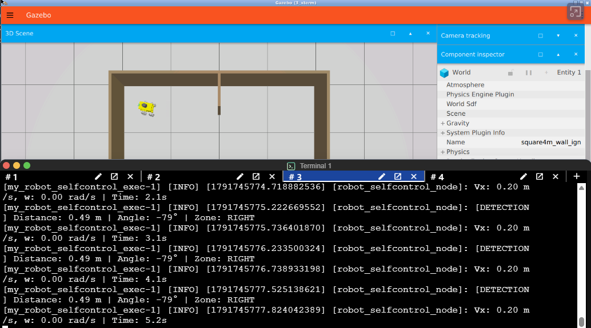
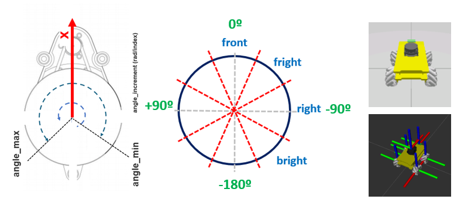
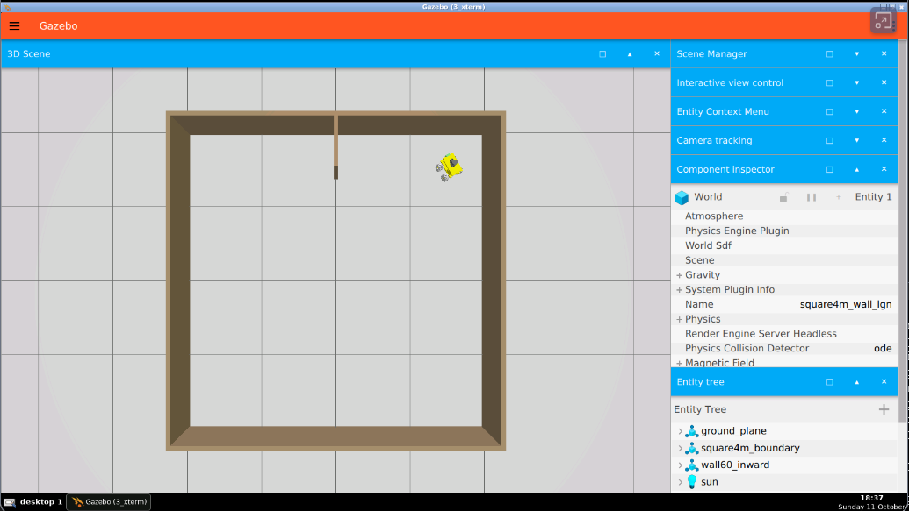
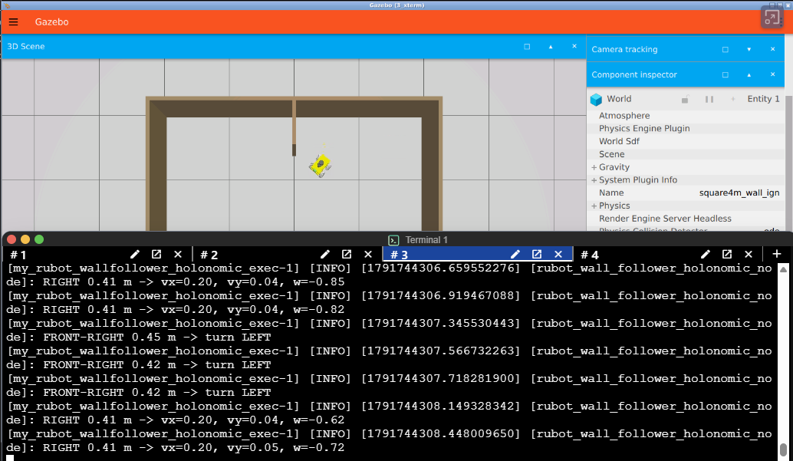

# **ROS2 rUBot Mecanum Control**

The objectives of this chapter are:
- control in virtual environment 
- control with real robot

We have created different activities in this section:
- Robot performances
    - Python programming control
- Autonomous control with obstacle avoidance
- Robot Wall follower

The final model represents the real robots we will use in the laboratory:
- rUBot mecanum custom made robot
- LIMO commercial mecanum robot
- ROSbot commercial robot


|  |  | |
|:--:|:--:|:--:|
| **rUBot** | **LIMO** | **ROSbot** |

**Bibliography:**
- [The Construct: Build Your First ROS 2 Based Robot](https://www.robotigniteacademy.com/courses/309)
- [LIMO ROS 2 repository](https://github.com/agilexrobotics/limo_ros2/tree/humble)
- [LIMO Pro ROS 2 user manual](https://github.com/agilexrobotics/limo_pro_doc/blob/master/Limo%20Pro%20Ros2%20Foxy%20user%20manual(EN).md)
- Kevin M. Lynch and Frank C. Park, *Modern Robotics: Mechanics, Planning, and Control*, Cambridge University Press, 2017.


## **1. Robot performances**

We will need to create a new package. This is already done, but if you want to do it from scratch:
```shell
ros2 pkg create --build-type ament_python my_robot_control --dependencies rclpy std_msgs sensor_msgs geometry_msgs nav_msgs
cd ..
colcon build --symlink-install
source install/setup.bash
```

### **1.1. Kinematics model of mecanum robot**
The rUBot mecanum is based on four wheels and has a Mecanum-drive kinematics model. We first have to analyse its kinematics model to control it properly.

Wheeled mobile robots may be classified in two major categories, holonomic (omnidirectional) and nonholonomic. 
- **Nonholonomic mobile robots**, such as conventional cars, employ conventional wheels, which prevents cars from moving directly sideways.
- **Holonomic mobile robots**, such as mecanum cars, employ omni or mecanum wheels, which allow lateral and diagonal movements

The rUBot mecanum corresponds to a kinematic model for a holonomic Mecanum-wheeled robot:

Omnidirectional wheeled mobile robots typically employ either omni wheels or mecanum wheels, which are typical wheels augmented with rollers on their outer circumference. These rollers spin freely and they allow sideways sliding while the wheel drives forward or backward without slip in that direction.

The **different movements** our car can perform are:


The **forces** involved define the robot linear and angular movement:


The **Forward Kinematics** equations are defined below:


where

- Vi: Linear speed of the wheels.
- ωdi: Angular speed of the wheels.
- Vir: Tangential speed of the rollers.
- ul: Linear velocity of the system on the X axis.
- uf: Linear velocity of the system on the Y axis.
- ω: Speed of rotation of the system on the Z axis.
- a: Distance from the center of the robot to the axis of rotation of the wheel.
- b: Distance from the center of the robot to the center of the width of the wheel.

>(see [Lynch & Park, 2017] for a complete derivation of this model).

In the **Inverse Kinematics** we want to apply a robot movement defined by:
- a linear and angular velocity using a Twist message type published in a /cmd_vel topic. 
- we need to calculate the 4 wheel speeds needed to obtain this robot velocity

This is defined by the following expressions:


To obtain the **odometry**, we use the information `(uf, ul, ω)`, and the Gazebo plugin calculates the pose of the robot.

The analytical expressions are explained graphically in the picture:


For the real mecanum robot, odometry is calculated by the robot driver running on the robot's Arduino-compatible controller.

### **1.2. Robot control**

We will first drive the robot with a specific `Twist` message.

We can control the movement of our robot programmatically in Python by creating a `/my_robot_control_node` node.

We will do it first in virtual environment and later with the real robot.

**Virtual environment**

A first simple control program is created to move the robot according to a specific `Twist` message.

- We first bring up the robot in a specific world at the desired pose:
```shell
ros2 launch my_robot_bringup my_robot_bringup_gz.launch.py world:=square4m_wall_ign.world robot_model:=rubot/rubot_mecanum.urdf.xacro x:=1.5 y:=-1.5 yaw:=0.5
```


- We will create now a first robot control python file "my_robot_control.py" to define a rubot movement with linear and angular speed during a time td

- We have to add in "setup.py" the entry point corresponding to the created node and the executable name after compilation process

    ```python
        entry_points={
            'console_scripts': [
                'my_robot_control_exec = my_robot_control.my_robot_control:main',
            ],
        },
    ```
- Create "launch" folder
- Install the launch and config folders modifying the "setup.py" file

- Create specific launch file "my_robot_control.launch.xml" or "my_robot_control.launch.py" to launch the node and python file created above
- The parameter values can be updated:
    - In the node with the "declare parameter"
    - In the launch file with the parameter values
    - as arguments in command-line
- Compile again and execute:
    ```
    ros2 launch my_robot_control my_robot_control.launch.xml vx:=0.0 vy:=0.2 td:=5.0
    ```
    > Change parameter values to verify different movements

**Real robot**

The same simple control program created in virtual environment to move the robot is used for the real robot.

- We first bringup our real robot. Remember that this is already done when you power on the robot.

    

- We control the robot with the same node created for virtual environment:
    ``` shell
    ros2 launch my_robot_control my_robot_control.launch.xml vx:=0.0 vy:=0.2 w:=0.0 td:=5.0
    ```
To control the real rUBot safely, we use a LiDAR sensor to detect obstacles and avoid collisions.

### **1.3. LiDAR sensor**

The LiDAR sensor used in the real rUBot mecanum robot is an RPLIDAR A1. A typical scan covers the following angular range:
- angle_min: -3.141593 (rad)
- angle_max: 3.141593 (rad)

The number of samples and `angle_increment` can differ between the simulated and real LiDAR. The current Gazebo model uses 360 samples. Control algorithms must use `len(scan.ranges)`, `scan.angle_min` and `scan.angle_increment` instead of assuming a fixed number of beams.


- Verify the LiDAR configuration in the robot model and compare it with the data published on `/scan`.
- Bringup the rUBot mecanum model:
    ```shell
    ros2 launch my_robot_bringup my_robot_bringup_gz.launch.py world:=square4m_wall_ign.world robot_model:=rubot/rubot_mecanum.urdf.xacro x:=0.5 y:=0.0 yaw:=0.0
    ```
- A node is created to:
    - move the robot with a custom `Twist` message
    - measure the minimum distance and angle to any obstacle around the robot
    - If this minimum distance is lower than a threshold, the robot stops
    ```shell
    ros2 launch my_robot_control my_robot_lidar_test.launch.xml
    ```
    > you can modify the parameter values in the node

The delivered node is useful, but it has some important improvements:
- Optimize the Quality of Service (QoS) for the LiDAR sensor
    - Reliability:
        - RELIABLE (Default): Ensures all messages are delivered
        - BEST_EFFORT: Send data without guaranteeing delivery. Some messages may be lost.
    - History:
        - KEEP_LAST (Default): Keep only the last N messages
        - KEEP_ALL
    - Depth: Number of messages stored in the queue when using KEEP_LAST
    - Durability: 
        - VOLATILE (Default): Do not store messages
        - TRANSIENT_LOCAL: store all messages for 
                    late subscribers
    - You have to add:
    ```python
    from rclpy.qos import QoSProfile,QoSReliabilityPolicy,QoSHistoryPolicy,QoSDurabilityPolicy
    ...
    # LiDAR subscription
    scan_qos = QoSProfile(
        reliability=QoSReliabilityPolicy.BEST_EFFORT,
        history=QoSHistoryPolicy.KEEP_LAST,
        depth=5,
        durability=QoSDurabilityPolicy.VOLATILE
    )
    self.scan_sub = self.create_subscription(
        LaserScan,
        "/scan",
        self.scan_cb,
        scan_qos,
    )
    ```
    - Publisher and subscriber QoS profiles must be compatible. A `RELIABLE` subscriber is not compatible with a `BEST_EFFORT` publisher, while a `BEST_EFFORT` subscriber can receive data from either.
    - To see the QoS of a publisher:
    ```bash
    ros2 topic info /scan --verbose
    ```
    > Gazebo is usually `RELIABLE`, but the real LiDAR is usually `BEST_EFFORT`.
    > The current `my_robot_wallfollower.py` node already uses `qos_profile_sensor_data`, while the LiDAR test and self-control nodes still require this improvement.

- Minimize the computational cost of the LiDAR callback:
    - avoid arrays and find minimum directly
    - avoid logs

**Lab Session: rUBot control and LiDAR test**

The objectives of this lab session are:
- Understand and verify the LiDAR readings of the rUBot mecanum robot in Gazebo simulation
- Use the existing `my_robot_lidar_test.launch.xml` and `my_robot_lidar_test.py` files. Add the `vx`, `vy`, `w`, `stop_distance`, `fov_min_deg` and `fov_max_deg` arguments to the launch file and pass them to the node as parameters.
- Optimize the code according to the suggested modifications
- Verify first in Gazebo virtual environment and later with the real robot

## **2. Driving self-control using a LiDAR sensor**

We will use now the created world to test the autonomous navigation with obstacle avoidance performance. 

The algorithm implemented in `my_robot_selfcontrol.py` works as follows:
- The robot normally moves forward at the configured `forward_speed`.
- The LiDAR callback filters invalid readings and searches for the closest obstacle within a field of view from -150° to 150°.
- The angle of the closest reading is classified into `FRONT`, `LEFT`, `RIGHT`, `BACK_LEFT` or `BACK_RIGHT`.
- If the closest obstacle is nearer than `distance_limit`, the action depends on its zone:
    - `FRONT`: move backwards and turn left.
    - `LEFT`: move backwards and turn right.
    - `RIGHT`: move backwards and turn left.
    - `BACK_LEFT` or `BACK_RIGHT`: move forward without turning.
- When there is no obstacle inside `distance_limit`, the robot continues forward.
- A timer publishes the latest velocity command and stops the robot after `time_to_stop` seconds.

Let's verify first this behaviour in virtual environment

**VIRTUAL environment**

We have to launch the "my_robot_selfcontrol.launch.xml" file in the "my_robot_control" package.
```shell
ros2 launch my_robot_bringup my_robot_bringup_gz.launch.py world:=square4m_wall_ign.world robot_model:=rubot/rubot_mecanum.urdf.xacro x:=1.5 y:=-1.5 yaw:=0.5
ros2 launch my_robot_control my_robot_selfcontrol.launch.xml time_to_stop:=10.0
```


>- Verify in rviz if you have to change the fixed frame to "odom" frame
>- You can test the behaviour by tuning the defined parameters

**Activity: rUBot self-control**

The objective of this activity is:
- Optimize the code regarding the suggestions:
    - Quality of Service
    - Minimize the computational cost of the LiDAR callback
- Modify the code to move the robot in a holonomic way. For example, when the closest obstacle is on the right, move the robot sideways to the left.

Design the code using the holonomic robot capabilities, and upload:
- the file "my_robot_selfcontrol_holonomic.py"
- a video of the current behaviour in your designed world

**REAL robot**

We have to launch the same `my_robot_selfcontrol.launch.xml` file designed for Virtual environment.
```shell
ros2 launch my_robot_control my_robot_selfcontrol.launch.xml time_to_stop:=10.0
```
>Verify that the algorithm derives the scan size and angles from the `LaserScan` message and does not assume a fixed number of beams.

**Lab Session: rUBot selfcontrol**

The objectives of this lab session are:
- Verify the designed self-control behaviour in your rUBot mecanum robot in Gazebo simulation
- Validate the same behaviour with the real robot

## **3. Wall Follower**

The `my_robot_wallfollower.py` node divides the valid LiDAR readings into four angular regions and calculates the minimum distance in each region:
- `FRONT`: -20° to 20°.
- `FRONT_RIGHT`: -70° to -20°.
- `RIGHT`: -110° to -70°.
- `BACK_RIGHT`: -160° to -110°.

The controller evaluates these regions in priority order. A front or front-right obstacle makes the robot turn left. When the right wall is visible, the robot follows it. When the right reading is far but the back-right reading is close, the robot turns right around the end of the wall. If no wall is visible, the robot stops.

Two wall-follower nodes are available:

- **Differential version — `my_robot_wallfollower.py`:** uses forward velocity (`linear.x`) and rotation (`angular.z`). It turns left or right to maintain the desired distance from the right wall.
- **Holonomic version — `my_rubot_wallfollower_holonomic.py`:** also uses lateral velocity (`linear.y`). While following the right wall, it corrects the lateral distance and uses a proportional rotation to align the robot with the wall.

The algorithm is based on LiDAR range tests and specific actions for each region:


**VIRTUAL environment**

We have to launch the "my_robot_wallfollower.launch.xml" file in the "my_robot_control" package.
```shell
ros2 launch my_robot_bringup my_robot_bringup_gz.launch.py world:=square4m_wall_ign.world robot_model:=rubot/rubot_mecanum.urdf.xacro x:=1.5 y:=-1.5 yaw:=0.5
ros2 launch my_robot_control my_robot_wallfollower.launch.xml time_to_stop:=50.0
```

To test the holonomic version, keep the same simulation running and execute:

```shell
ros2 launch my_robot_control my_rubot_wallfollower_holonomic.launch.py time_to_stop:=50.0
```

>- You can test the behaviour by tuning the defined parameters


**Activity: rUBot wall-follower**

The objective of this activity is to modify the code to move the robot in a holonomic way, for example:
-  When the minimum distance is in the front side move the robot over the left side
- When the minimum distance is in the front-right side move the robot over the front-left side
- When the minimum distance is in the right side move the robot forward and maintain its orientation parallel to the wall
- When the minimum distance is in the back-right side move the robot over the front-right side
- When the minimum distance is in the back side move the robot over the right side

Test the code using the holonomic robot capabilities, and upload:
- the file `my_rubot_wallfollower_holonomic.py`
- a video of the current behaviour in your designed world

**REAL robot**

We have to launch the same `my_robot_wallfollower.launch.xml` file designed for the virtual environment.
```shell
ros2 launch my_robot_control my_robot_wallfollower.launch.xml time_to_stop:=50.0
```
>The real and simulated LiDAR may use different scan resolutions. The algorithm must calculate regions from the angles supplied in each `LaserScan` message rather than from fixed array indices.

**Lab Session: rUBot Wall Follower**

The objectives of this lab session are:
- Verify the designed wall-follower behaviour in your rUBot mecanum robot in Gazebo simulation
- Validate the same behaviour with the real robot

## **4. Go to pose**

The `my_robot_go2pose.py` node uses the odometry received on `/odom` to drive the robot towards a desired pose and publishes velocity commands on `/cmd_vel`. The target parameters are:
- `x`: target X coordinate in metres in the odometry frame.
- `y`: target Y coordinate in metres in the odometry frame.
- `f`: final orientation in degrees.

First launch the simulation and then launch the controller with the desired target pose:

```shell
ros2 launch my_robot_bringup my_robot_bringup_gz.launch.py world:=square4m_wall_ign.world robot_model:=rubot/rubot_mecanum.urdf.xacro x:=1.0 y:=1.0 yaw:=1.8
ros2 launch my_robot_control my_robot_go2pose.launch.xml x:=1.0 y:=1.0 f:=90.0
```

The target coordinates are expressed relative to the `/odom` frame. In RViz, select `odom` as the fixed frame when checking the trajectory and target orientation.
