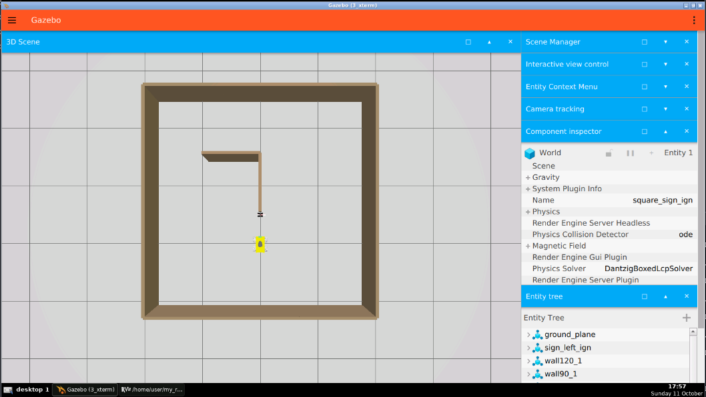
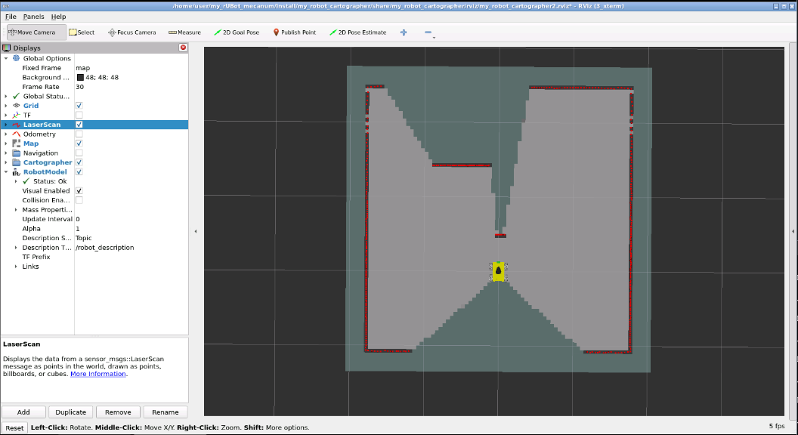
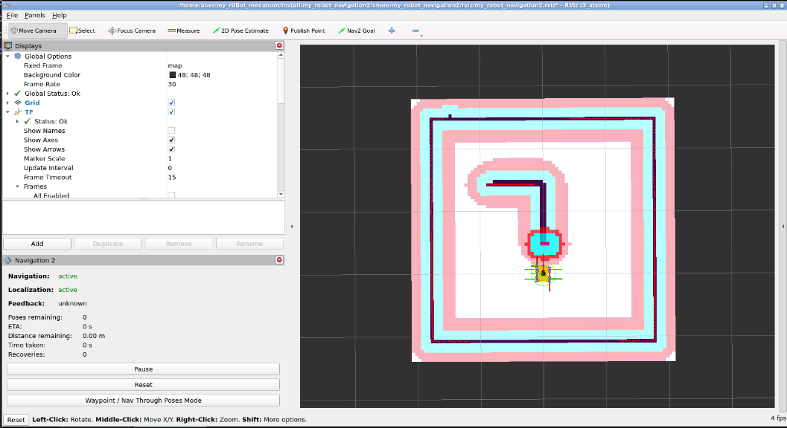
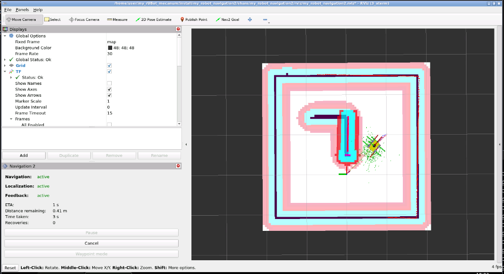
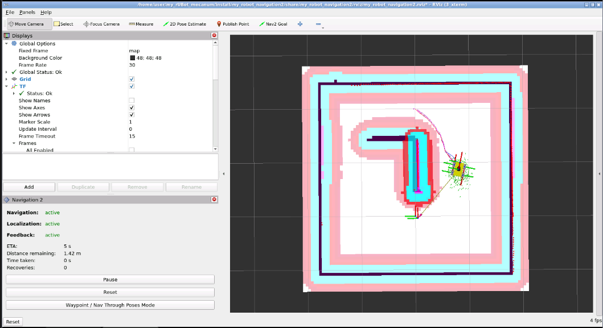

# **4. ROS 2 rUBot SLAM Navigation**

The objectives of this section are to:

- generate a 2D occupancy map while localizing the robot with SLAM;
- save the generated map;
- localize the robot on a known map and navigate autonomously with Nav2;
- send navigation goals programmatically with the Simple Commander API.

Useful documentation:

- [ROS 2 Nav2 Stack course by Edouard Renard](https://www.udemy.com/course/ros2-nav2-stack/learn/lecture/35488788#overview)
- [The Ultimate Guide to the ROS 2 Navigation Stack](https://automaticaddison.com/the-ultimate-guide-to-the-ros-2-navigation-stack/)
- [AgileX LIMO ROS 2 Humble documentation](https://github.com/agilexrobotics/limo_ros2_doc/blob/master/LIMO-ROS2-humble(EN).md)
- [ROS 2 mapping and navigation with AgileX LIMO](https://discourse.ros.org/t/ros2-mapping-and-navigation-with-agilex-limo-ros2/37439)
- [The Construct Robotics workspaces](https://bitbucket.org/theconstructcore/workspace/projects/ROB)
- [Weston Robot LIMO ROS 2 Docker](https://github.com/westonrobot/limo_ros2_docker/tree/humble)
- [TurtleBot3 repository](https://github.com/ROBOTIS-GIT/turtlebot3/tree/main)

SLAM (Simultaneous Localization and Mapping) simultaneously creates a map of an unknown environment and estimates the robot pose within it.

Once the map has been generated, Nav2 uses it to localize the robot, plan a path to a target pose and execute that path while avoiding obstacles. Therefore, SLAM is responsible for mapping and localization, whereas Nav2 is responsible for autonomous navigation.

There are different SLAM methods available in ROS 2:

- SLAM Toolbox: creates 2D occupancy maps from laser scans and odometry and is widely used with Nav2 in indoor environments.
- Cartographer: provides real-time SLAM in 2D and 3D and supports multiple platforms and sensor configurations.
- RTAB-Map: provides visual, RGB-D and lidar SLAM and supports a wide range of platforms and sensors.

> `gmapping` is commonly used in ROS 1. For ROS 2 Humble, SLAM Toolbox is the usual 2D alternative.

## **4.1. SLAM and Navigation installation**

First, install the required packages. They are already installed in The Construct environment and in our custom SSD environment:

```shell
sudo apt update
sudo apt install ros-humble-cartographer
sudo apt install ros-humble-cartographer-ros
sudo apt install ros-humble-navigation2 ros-humble-nav2-bringup
sudo apt install ros-humble-nav2-simple-commander
sudo apt install ros-humble-tf-transformations
```

We have created specific packages based on the equivalent TurtleBot3 project (Waffle model):

- `my_robot_cartographer`
- `my_robot_navigation2`

The `my_robot_nav_control` package provides navigation control projects based on the Simple Commander API. It was created with:

```shell
ros2 pkg create --build-type ament_python my_robot_nav_control --dependencies rclpy std_msgs sensor_msgs geometry_msgs nav_msgs nav2_simple_commander tf_transformations
```

These three packages are organized in the `src/Navigation_Projects` subfolder with the following structure:

- `Navigation_Projects`
  - `my_robot_cartographer`
  - `my_robot_navigation2`
  - `my_robot_nav_control`

## **4.2. Generate a Map with SLAM**

- First, bring up the robot in the desired environment at the initial pose `[0.0, 0.0, 0.0]`:
  - For the simulated environment:

    ```shell
    ros2 launch my_robot_bringup my_robot_bringup_gz.launch.py world:=square_sign_left_ign.world robot_model:=rubot/rubot_mecanum.urdf.xacro x:=0.0 y:=0.0 yaw:=0.0
    ```
    
    > Change `world` to the name of the world you have created.

  - For the real robot, the bringup is already running when the robot is turned on.

- Generate the map:
  - For the simulated environment:

    ```shell
    ros2 launch my_robot_cartographer cartographer.launch.py use_sim_time:=true
    ```
    

    > Use `use_sim_time:=true` with Gazebo Sim. It is enabled by default in `cartographer.launch.py`.

  - For the real robot, first reset its odometry at the pose that will be used as the map origin, and then launch Cartographer:

    ```shell
    ros2 topic pub --once /reset_odom std_msgs/msg/Bool "{data: true}"
    
    ros2 launch my_robot_cartographer cartographer.launch.py use_sim_time:=false
    ```

- Drive the robot around the environment to generate the map:

  ```shell
  ros2 run teleop_twist_keyboard teleop_twist_keyboard
  ```

- Save the map in the `my_robot_navigation2/map` folder:

  ```shell
  cd src/Navigation_Projects/my_robot_navigation2/map/
  ros2 run nav2_map_server map_saver_cli -f my_map
  ```

- To inspect the generated map, install and use ImageMagick:

  ```shell
  sudo apt update
  sudo apt install imagemagick
  display my_map.pgm
  ```

## **4.3. Navigate inside the Map**
When using **Gazebo Virtual environment**:
- Bring up the simulated robot at the same pose used to start mapping:

  ```shell
  ros2 launch my_robot_bringup my_robot_bringup_gz.launch.py world:=square_sign_left_ign.world robot_model:=rubot/rubot_mecanum.urdf.xacro x:=0.0 y:=0.0 yaw:=0.0
  ```

- Launch the navigation stack. Use only the command corresponding to the sensor configuration in use:

  ```shell
  # General Gazebo Sim configuration
  ros2 launch my_robot_navigation2 navigation2_robot.launch.py use_sim_time:=true map_file:=map_square_sign_ign.yaml params_file:=rubot_sw_ign.yaml

  # Gazebo Sim configuration optimized for lidar navigation
  ros2 launch my_robot_navigation2 navigation2_robot.launch.py use_sim_time:=true map_file:=map_square_sign_ign.yaml params_file:=rubot_sw_lidar_ign.yaml
  ```

  `rubot_sw_ign.yaml` is the general Gazebo Sim configuration, whereas `rubot_sw_lidar_ign.yaml` contains the configuration optimized specifically for lidar navigation. Both set the initial pose to `[0.0, 0.0, 0.0]` and include parameters adapted to the mecanum robot and Gazebo Sim.

  
  

When using **Real robot**:
- Before launching Nav2, physically place the robot at the pose defined as `[0.0, 0.0, 0.0]` when the map was created. Keep the robot stationary and reset its odometry:

  ```shell
  ros2 topic pub --once /reset_odom std_msgs/msg/Bool "{data: true}"
  ```

  > Perform the odometry reset before launching Nav2. This makes the initial `odom` pose consistent with the map origin and avoids a discontinuity while the navigation stack is active.

- Launch the navigation stack:

  ```shell
  ros2 launch my_robot_navigation2 navigation2_robot.launch.py use_sim_time:=false map_file:=my_map.yaml params_file:=rubot_real.yaml
  ```

- If the initial pose is not configured, localize the robot on the map using **2D Pose Estimate** in RViz. The global planner and controller can then start operating correctly.
- Navigate on the map with Nav2:
  - Select one target pose.
  - Select multiple waypoints with the **Waypoint/Nav Through Poses Mode** option:
    - Select different **Nav2 Goal** poses in RViz.
    - Choose **Start Waypoint Following** to visit the selected poses individually.
    - Choose **Start Nav Through Poses** to calculate a single optimized trajectory through the selected poses.

## **4.4. Interact Programmatically with Nav2**

The Simple Commander API provides a Python interface to Nav2 topics, services and actions.

Relevant topics:

- `/initialpose` (`geometry_msgs/msg/PoseWithCovarianceStamped`)

Relevant actions:

- `/navigate_to_pose`
- `/follow_waypoints`

Main class:

- `BasicNavigator()`

Main methods:

- `.setInitialPose(pose)`
- `.waitUntilNav2Active()`
- `.followWaypoints(pose_list)`
- `.goToPose(pose)`

Install the following packages if they are not already available in the custom SSD environment:

```shell
sudo apt install ros-humble-nav2-simple-commander
sudo apt install ros-humble-tf-transformations
```

We can create a Python node to interact with the Nav2 topics and actions. To navigate programmatically with the Simple Commander API:

- Bring up the robot in the desired environment:
  - For the simulated environment:

    ```shell
    ros2 launch my_robot_bringup my_robot_bringup_gz.launch.py world:=square_sign_left_ign.world robot_model:=rubot/rubot_mecanum.urdf.xacro x:=0.0 y:=0.0 yaw:=0.0
    ```

  - For the real robot, the bringup is already running when the robot is turned on.

- Start `navigation2_robot.launch.py` with RViz to monitor the robot navigation:
  - For the simulated environment:

    ```shell
    ros2 launch my_robot_navigation2 navigation2_robot.launch.py use_sim_time:=true map_file:=map_square_sign_ign.yaml params_file:=rubot_sw_ign.yaml
    ```
    

  - For the real robot:

    ```shell
    # Place the robot at the map origin [0.0, 0.0, 0.0] and reset odometry first
    ros2 topic pub --once /reset_odom std_msgs/msg/Bool "{data: true}"

    ros2 launch my_robot_navigation2 navigation2_robot.launch.py use_sim_time:=false map_file:=my_map.yaml params_file:=rubot_real.yaml
    ```

    > It is important to specify `use_sim_time:=false` for the real robot because it is set to `true` by default in `navigation2_robot.launch.py`.

- Launch the Python node using the initial pose and target waypoints defined in the `config` folder:

  ```shell
  ros2 launch my_robot_nav_control nav_waypoints.launch.py wp_file:=waypoints_sw_ign.yaml
  ```
  

- The parameters are defined in `waypoints_sw_ign.yaml`. Each pose uses the format `[x, y, yaw]`, expressed in the `map` frame, with `yaw` in radians:

  ```yaml
  initial_pose: [0.0, 0.0, 0.0]
  waypoints:
    - [1.0, -1.0, 0.0]
    - [2.0, 0.0, 1.57]
  final_pose: [2.0, 1.0, 1.57]
  ```

  > If the waypoint list is empty (`waypoints: []`), the robot will navigate directly from `initial_pose` to `final_pose`.

  In the future, `wp_file` could use the standard ROS parameter-file structure shown below. The current `nav_waypoints.py` implementation does not yet support this format and expects the flat structure shown above:

  ```yaml
  nav_waypoints_node:
    ros__parameters:
      initial_pose: [0.0, 0.0, 0.0]
      waypoints:
        - [1.5, 0.5, 0.3]
        - [3.4, 0.5, -0.5]
      final_pose: [4.7, 0.5, 1.57]
  ```
